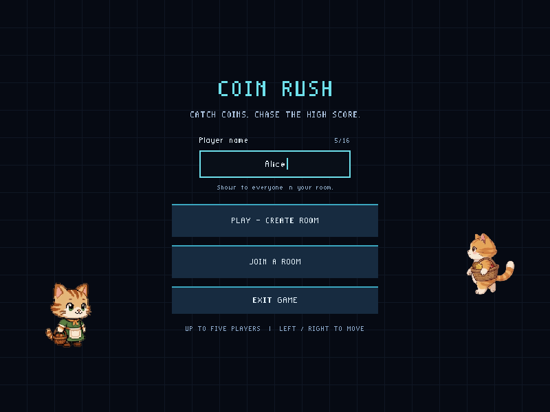

# Coin Rush

Catch coins, dodge bombs and compete for the highest score across three levels.
Coin Rush is a real-time multiplayer game written in C with GLFW, OpenGL and
Cyclone DDS. Each room supports **2-5 players** and one server can run up to
**8 rooms**.



## Play on Windows

You need WSL 2 with working WSLg graphics and a Linux distribution containing
**Cyclone DDS 0.10.4 or 0.10.5**. Each computer builds its own Linux executable.
The launchers check dependencies and can install missing development packages
on Debian/Ubuntu using `apt`.

1. On the host computer, double-click **`server.bat`** and keep its window open.
2. Open **`client.bat`** on the host and each player's computer.
3. When prompted for a WSL distribution, enter its installed name, such as `Ubuntu`.
   The launcher remembers the choice.
4. Enter your display name. One player chooses **Create Room** and shares the
   six-digit room code; everyone else chooses **Join a Room**.
5. Every player presses **Ready** or **Enter**. The match starts once at least
   two players are present and everyone is ready.

Display names accept up to 16 letters, digits, spaces, hyphens or underscores.

For local testing, open `client.bat` more than once. Clients automatically choose
different available local credentials. **Only the focused client window plays
audio**, so several local windows do not stack their music.

Players on another computer need a one-time invite from the host; see
[Set up another computer](#set-up-another-computer).

## How a match works

| Stage | Duration | What changes |
| --- | --- | --- |
| Level 1 | 30 seconds | Catch normal coins for **1 point** and gold coins for **3 points**. |
| Level 2 | 30 seconds | Coins fall faster and bombs appear. Each bomb hit deducts **3 points**. |
| Level 3 | 30 seconds | Red floor warnings precede bomb bursts, with gold coins tempting players into danger zones. Warnings become more frequent near the end. |
| Tie-breaker | 15 seconds | Tied leaders compete in a coin-only round while other players spectate. Another tie repeats the bonus round among its tied leaders. |

- Scores carry across the three levels. Bomb penalties stop at zero; nobody is eliminated.
- At each level break, everyone must confirm before the next level begins.
  A green checkmark confirms your vote and the ready count shows the room's progress.
- The final leaderboard ranks players by their total score. Bonus points resolve
  first-place ties separately from that total.
- There is no automatic rematch. Everyone must confirm **Continue to Next Round**;
  a new match resets all scores to zero.
- Duplicate ready clicks count once. Players who leave are removed from the ready count.

## Controls

| Action | Control |
| --- | --- |
| Move left/right | **A / D** or **Left / Right arrows** |
| Confirm readiness | **Enter** or the on-screen Ready/Continue button |
| Join a room | Enter its six-digit code, then press **Enter** or click **Join Room** |
| Edit a name or room code | Hold **Backspace** to erase; **Ctrl+A** selects all; typing replaces the selection; **Backspace/Delete** clears it |
| Toggle fullscreen | **F11** |
| Open the exit confirmation | **Escape** during a match |
| Mute/unmute | Click the **speaker icon** |
| Adjust audio volume | Click **- / +** or the volume bars |

Each level and the bonus round have their own music track. Coin pickups and
bomb hits play sound effects. Volume controls use a separate tick, whose level
follows the volume setting. Music is mixed below the effects.

Windows can be resized freely; the arena keeps its 4:3 layout with letterboxing.

## Build and run in WSL/Linux

Run commands from the project root. The build needs a C11 compiler, Cyclone DDS,
GLFW, OpenGL, OpenSSL and SDL2_mixer development packages. The Makefile checks
these dependencies and offers automatic installation on Debian/Ubuntu. Secure
invite transfer also uses GnuPG and `tar`.

```sh
make
```

This generates the DDS message code, builds the server and client and creates
local credentials if none exist. Build outputs live in `build/`; runnable copies
are also installed as `./server` and `./client` for the launchers.

Start the server, then open clients in separate terminals:

```sh
./server
```

```sh
./client
```

Or start a server and the first client together with `make run`, then use
`make run-player2` in another terminal. The Create/Join menu and ready votes
still apply.

## Set up another computer

Each remote player needs a distinct credential signed by the host's authority.
Do this once per player:

1. Start `server.bat` on the host to complete its initial setup.
2. On the host, run **`create-invite.bat`** and select an unused identity from
   `client2` through `client6`. Choose a passphrase when prompted.
   The WSL equivalent is `make invite PLAYER=client2`.
3. Put that player's encrypted `.gpg` invite in the guest's project folder under
   `invites/`. Share its passphrase separately.
4. The guest runs **`client.bat`** and enters the passphrase. The launcher verifies
   and imports the credential, then opens the Create/Join menu. Later launches
   only need `client.bat`.

The import stores credentials in private WSL user storage. Share only the
player's encrypted invite, **never** the host's `credentials-private/` folder,
server identity or authority private key. Credential identities authenticate
connections; display names do not grant access to another player's session.

### LAN discovery on Windows

Both computers must be able to discover the same server. WSL's default NAT
networking can block DDS discovery between computers. On supported Windows 11
systems, add this to `%UserProfile%\.wslconfig` on both computers:

```ini
[wsl2]
networkingMode=mirrored
```

Apply the change with `wsl --shutdown` in PowerShell, then reopen WSL and the game.
This stops all running WSL distributions, so finish other WSL work first.

If discovery is still blocked, run the following in an administrator PowerShell
window on each computer. Replace `192.168.1.0/24` with your trusted LAN subnet:

```powershell
New-NetFirewallHyperVRule -Name "CoinRushDDS" -DisplayName "Coin Rush DDS" `
  -Direction Inbound -VMCreatorId '{40E0AC32-46A5-438A-A0B2-2B479E8F2E90}' `
  -Protocol UDP -LocalPorts 17900-17941 -RemoteAddresses 192.168.1.0/24 `
  -Action Allow
```

The normal game configuration uses DDS participant indices 0-15. The rule is
restricted to its discovery ports and the specified subnet.

## Testing

Build first, then run the checks from the project root:

```sh
make test            # Gameplay, client input/audio and network validation
make qa              # Full integration, security, room isolation and a real match
make test-sanitize   # AddressSanitizer and UndefinedBehaviorSanitizer checks
```

QA evidence is written to `build/qa/`. Client audio tests use a dummy audio device
so automated tests do not depend on speakers or an active game window.
`make profile` provides server-polling measurements for the local machine.

The implementation uses SSE2 collision comparisons on supported x86 targets,
with a scalar fallback and four-way loop unrolling in coin updates. Run
`make profile` on the target machine for performance measurements.

## Implementation

The server owns movement, coin pickups, bomb penalties, timers, ready votes and
results. Clients send input; the server updates positions and scores.
DDS connections use signed player identities, encrypted private channels,
session tokens, sequence checks and room isolation. The server validates
incoming names and input independently of the UI.

## Project layout

```text
assets/       Graphics, music and sound effects
include/      Shared game and networking headers
protocol/     DDS message definitions
scripts/      WSL launchers and credential helpers
src/          Client, server, game rules and networking
tests/       Gameplay, client, network and QA tests
vendor/       Third-party pixel font
docs/        README screenshots
build/        Generated code, executables, test data and logs (Git-ignored)
```

`Makefile`, `server.bat`, `client.bat` and `create-invite.bat` remain at the root.
The shared Windows launcher is **`scripts/run-game.bat`**; it calls
**`scripts/run-game-wsl.sh`** inside the selected WSL distribution.

The third-party font is in `vendor/stb_easy_font.h`. Bundled effect asset notes
and license files are retained in `assets/effects/source/`.

## Troubleshooting

- **The launcher asks for a distro:** use an installed name from `wsl --list --quiet`.
  The selected distro must provide a supported Cyclone DDS version.
- **A guest cannot connect:** check its invite belongs to this host, that each
  player uses a different identity and that LAN discovery is allowed.
- **The match stays in the lobby:** at least two players and all ready votes are required.
- **Audio is silent:** focus the client window and check the speaker icon and bars.
  Unfocused clients are intentionally silent.
- **The UI or audio still looks old after an update:** close and reopen every
  client and the server so all processes use the same build and message format.
- **A rebuild is needed:** `make clean && make` regenerates build outputs.
  It preserves `credentials-private/` and your encrypted invites.
