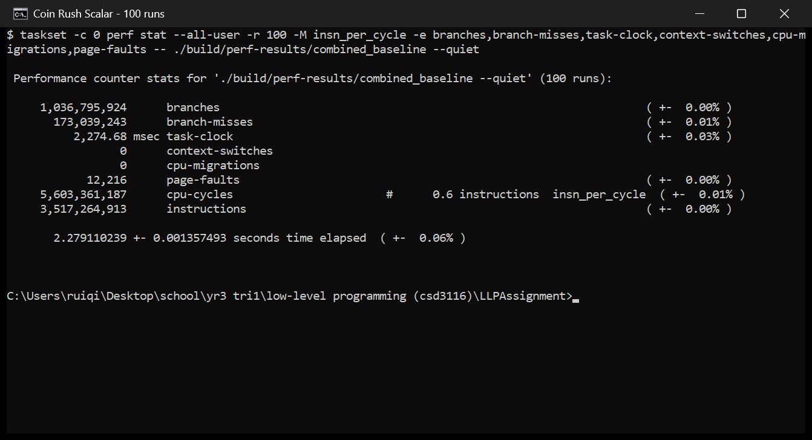
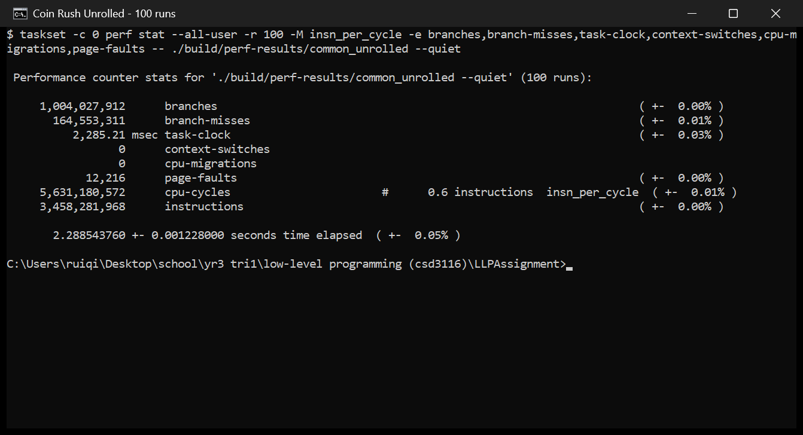
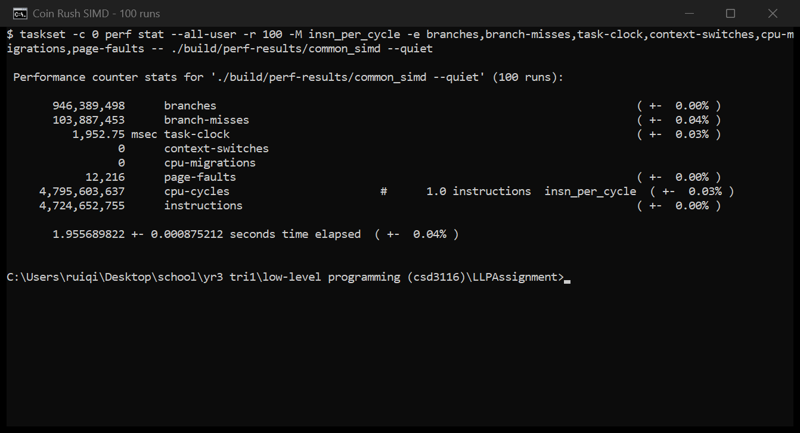
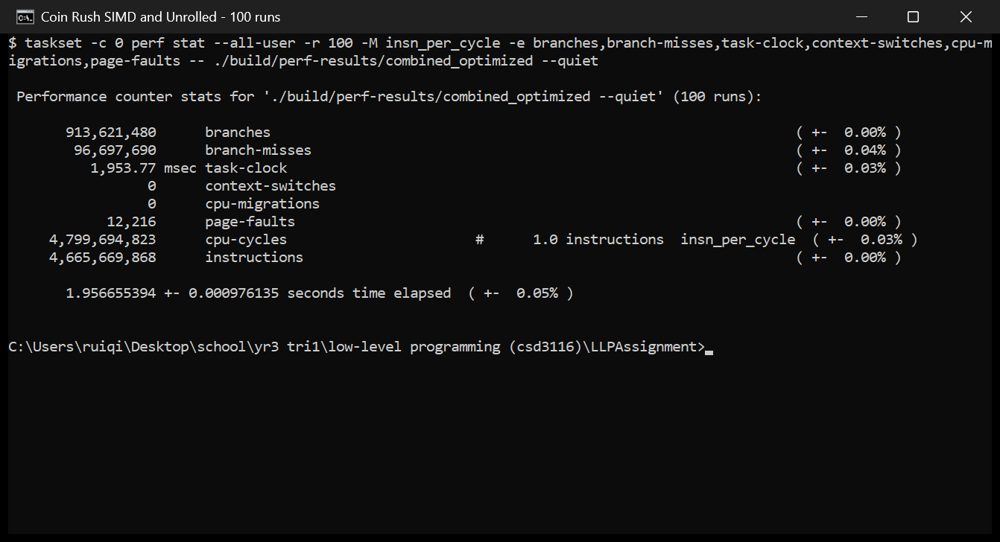

# Coin Rush performance results

All four versions run the same workload. Each version was measured in **100 separate perf runs** on the course Linux server. Each process makes 100 batch calls.

## Versions

| Version | Collision checks | Coin updates |
| --- | --- | --- |
| Scalar | Scalar | Ordinary scalar loop |
| Unrolled | Scalar | Four coin updates per iteration |
| SIMD | SSE2 | Ordinary scalar loop |
| SIMD and unrolled | SSE2 | Four coin updates per iteration |

## Results

| Metric | Scalar | Unrolled | SIMD | SIMD and unrolled |
| --- | ---: | ---: | ---: | ---: |
| CPU cycles | 5,603,361,187 | 5,631,180,572 | 4,795,603,637 | 4,799,694,823 |
| Instructions | 3,517,264,913 | 3,458,281,968 | 4,724,652,755 | 4,665,669,868 |
| IPC | 0.6277 | 0.6141 | 0.9852 | 0.9721 |
| Branches | 1,036,795,924 | 1,004,027,912 | 946,389,498 | 913,621,480 |
| Branch misses | 173,039,243 | 164,553,311 | 103,887,453 | 96,697,690 |
| Branch miss rate % | 16.6898 | 16.3893 | 10.9772 | 10.5840 |
| Execution time s | 2.279110 | 2.288544 | 1.955690 | 1.956655 |

The values are means across 100 process runs. IPC is calculated as mean instructions divided by mean CPU cycles. The screenshots show perf's rounded IPC value.

## What changed

**Unrolled:** execution time was **0.41% higher** than scalar. CPU cycles changed by +0.50%, instructions by -1.68% and branches by -3.16%.

**SIMD:** execution time was **14.19% lower** than scalar. CPU cycles changed by -14.42%, instructions by +34.33% and branches by -8.72%.

**SIMD and unrolled:** execution time was **14.15% lower** than scalar. CPU cycles changed by -14.34%, instructions by +32.65% and branches by -11.88%.

## Reading the results

Lower execution time and fewer CPU cycles indicate better performance for this workload. IPC measures instructions completed per cycle; a higher IPC alone does not prove a speedup because total instructions can also change.

Branches count control-flow instructions. Branch misses count mispredictions. Fewer instructions or branches do not guarantee shorter execution time. Code size, dependencies and memory behavior can affect the result; the counters do not identify every bottleneck by themselves.

These are large-batch function benchmarks. They do not establish a game frame-rate improvement. Regressions are reported alongside improvements.

## Screenshots

### Scalar



### Unrolled



### SIMD



### SIMD and unrolled



## How we measured

- Server CPU: Intel Xeon W3505 at 2.53 GHz; GCC 15.2.0; perf 7.0.14.
- Every batch performs 262,144 collision queries and updates eight coins in each of 65,536 game states.
- All four versions use identical deterministic inputs and produce checksum 139365540.
- SIMD calls the real find_overlapping_player function. Unrolling calls the real move_coins function. The scalar implementations preserve the same rules and update order.
- Correctness checks cover 100,000 collision queries and coin updates, including respawns. Memory checks passed locally.
- The timed coin workload avoids respawns, so random-number generation does not dominate the comparison.
- All measurements run sequentially on CPU 0. This is a shared server; pinning does not guarantee that it was otherwise idle.
- Counters use --all-user. Execution time is the complete process wall time, including initialization and cleanup.
- The scalar and combined measurements reuse their completed 100-run results. The two single-optimization versions were then measured on that same workload.
- The screenshot images are native CMD captures displaying saved, unedited server commands and perf output. No numbers were drawn into the images.

## Compiler settings

All versions use these base flags; only the switches selecting explicit SIMD and unrolling differ. Automatic vectorization and automatic unrolling are disabled in every version to isolate the techniques.

```text
-std=c11 -D_DEFAULT_SOURCE -O2 -g -Iinclude
-fno-tree-vectorize -fno-tree-slp-vectorize -fno-unroll-loops
```

## Reproducing the test

The backup archive contains the C driver, runner scripts, game source and header and raw measurements. GCC, perf and taskset are sufficient; DDS, OpenGL and SDL are not required. Nothing was installed on the course server.

The executable names in the screenshot commands refer to their benchmark workload. combined_baseline is Scalar; common_unrolled is Unrolled; common_simd is SIMD; combined_optimized is SIMD and unrolled.
